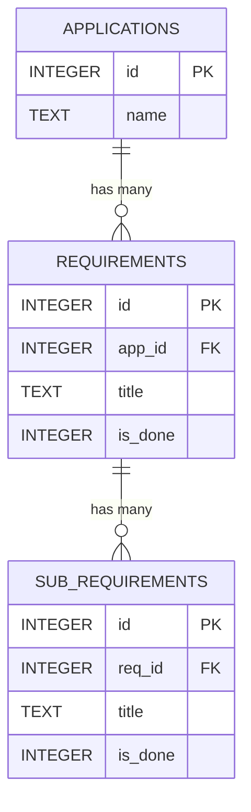

# 📋 ReqTracker (Requirement & Specification Tracker)

[](https://react.dev/)
[](https://vitejs.dev/)
[](https://sql.js.org/)
[](https://tailwindcss.com/)
[](LICENSE)

**ReqTracker** is a fast, offline-first client-side requirements and functional specification management tool. Powered by an embedded SQLite database running via WebAssembly (`sql.js`), ReqTracker allows engineers, product managers, and developers to organize, breakdown, and track project requirements hierarchically—with zero backend setup required.

---

## ✨ Features

- 📁 **Multi-Application Workspace**: Manage multiple projects and applications in an organized sidebar with instant switching.
- 🌳 **Hierarchical Requirement Breakdown**:
  - **Parent Requirements**: High-level functional modules (e.g., *Authentication*, *Billing Engine*, *Search*).
  - **Sub-Requirements (`F1, F2, ...`)**: Granular functional specs mapped directly to parent features.
- ⚡ **Client-Side SQLite Engine (WASM)**: Powered by `sql.js` (WebAssembly-compiled SQLite). Run real SQL queries and relational operations directly in the browser.
- 💾 **Automatic Local Persistence**: Exports binary SQLite database snapshots directly into `localStorage` for complete data privacy and offline readiness.
- 📋 **Smart Bulk Text Import**: Paste unstructured lists or specification documents; the parser automatically detects bullet points, regex tokens (`F1`, `F2.`, etc.), and converts them into structured sub-requirements in seconds.
- 🎯 **Batch Selection & Bulk Actions**: Dedicated multi-selection mode to select and delete multiple requirements/sub-requirements at once, alongside one-click wipe operations.
- ✏️ **Inline Editing**: Quick inline editing for application names, parent requirement titles, and sub-requirements.
- ✅ **Cascading Checklist & Progress Tracking**: Check off tasks as you build. Completing a parent requirement automatically cascades completion to all child sub-requirements.

---

## 🏗️ Relational Schema

ReqTracker maintains strict relational structure client-side via SQLite:



---

## 🛠️ Tech Stack

| Category | Technology |
|---|---|
| **Frontend Framework** | [React 19](https://react.dev/) |
| **Bundler & Dev Server** | [Vite 8](https://vitejs.dev/) |
| **Styling** | [Tailwind CSS v4](https://tailwindcss.com/) |
| **Database** | [sql.js](https://sql.js.org/) (SQLite compiled to WebAssembly) |
| **Icons** | [Lucide React](https://lucide.dev/) |
| **Storage** | Browser `localStorage` (Binary Uint8Array export) |

---

## 🚀 Getting Started

### Prerequisites

Ensure you have [Node.js](https://nodejs.org/) (version 18 or higher) and `npm` installed on your machine.

### Installation

1. **Clone the repository:**
   ```bash
   git clone https://github.com/your-username/req-tracker.git
   cd req-tracker
   ```

2. **Install dependencies:**
   ```bash
   npm install
   ```

3. **Start the local development server:**
   ```bash
   npm run dev
   ```
   Open your browser and navigate to `http://localhost:5173`.

### Building for Production

To create an optimized production build:
```bash
npm run build
```

To preview the production bundle locally:
```bash
npm run preview
```

---

## 📖 How to Use

1. **Create an Application**: In the sidebar on the left, type an application name and click the `+` button.
2. **Add Requirements**: Select the application from the list, enter a requirement title (e.g., *User Profile*), and click **Ajouter**.
3. **Add Sub-Requirements**:
   - **Single mode**: Enter sub-task text and press `Enter` or click **Ajouter**.
   - **Bulk mode**: Click **Ajout depuis un texte**, paste your raw functional specifications (e.g., lines starting with `F1.`, `F2.`, or bullet points), and click **Extraire et Ajouter**.
4. **Track Progress**: Click the checkbox next to any requirement or sub-requirement to toggle completion status.
5. **Batch Management**: Click **Sélectionner** in the top-right header to enter multi-select mode and batch delete items.

---

## 🔒 Privacy & Offline Capability

All data is stored directly in your browser's `localStorage` using WebAssembly SQLite. No database servers, accounts, or cloud syncs are required—your data stays 100% on your machine.

---

## 📄 License

This project is open-source and licensed under the [MIT License](LICENSE).
